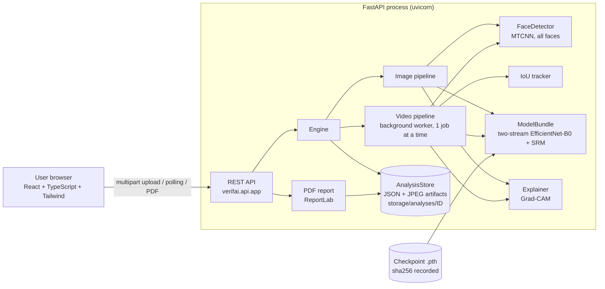
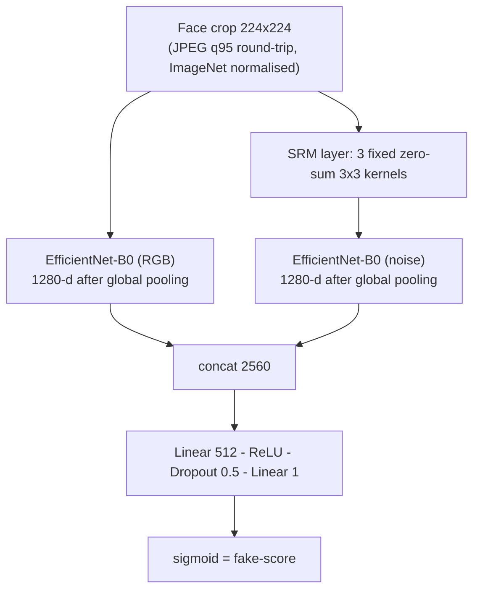
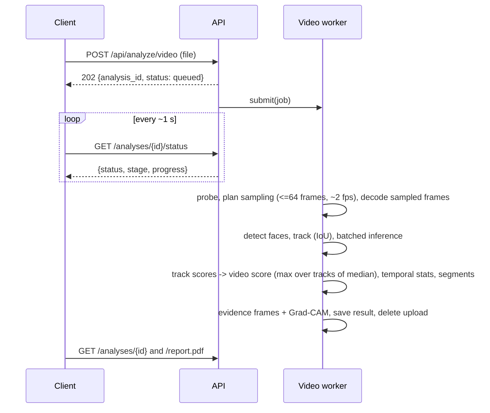

# Architecture

Verif-AI is a self-hosted application: a React single-page UI talks to a FastAPI service that runs a PyTorch face-forensics model on the same machine. No external AI API is used, and no database is required.

## 1. System overview



## 2. Modules (`backend/verifai/`)
| Module | Responsibility |
|---|---|
| `config.py` | Settings from environment / `.env`; **fixed** constants: decision threshold 0.5, input 224, JPEG quality 95, MTCNN margin 20 |
| `model.py` | `SRMLayer`, `TwoStreamNet` (architecture unchanged), checkpoint loading (`weights_only=True`, `strict=True`, raw and `{state_dict, meta}` formats), `ModelBundle` with a lock for thread-safe inference |
| `preprocess.py` | Training-consistent preprocessing (crop → JPEG q95 round-trip → ImageNet normalisation) |
| `faces.py` | `FaceDetector` (MTCNN `keep_all`, detection on a down-scaled copy, crops from the original) and `IoUTracker` |
| `image_pipeline.py` | Dedicated image analysis: validation, EXIF-aware decode, multi-face scoring, max aggregation, annotation, heat-maps |
| `video_pipeline.py` | Metadata, sampling plan, sequential decode, detection, tracking, batched inference, track/video aggregation, temporal statistics, suspicious segments, evidence frames |
| `scoring.py` | Classification policy (fixed 0.5 + abstention band), aggregation methods, temporal statistics, segments |
| `explain.py` | Grad-CAM (RGB stream, last MBConv block, target = fake score) |
| `report.py` | PDF forensic report |
| `engine.py` | Wires everything; image requests run synchronously; one background worker for videos |
| `store.py` | Filesystem persistence (no database): `job.json`, `result.json`, artifacts; TTL cleanup; ID/artifact-name validation |
| `schemas.py` | Pydantic models (API contract) |
| `api/app.py` | FastAPI factory, upload handling, error mapping, CORS, optional static serving of the built UI |

Training and data tooling live in `backend/training/` (not imported by the server): `fetch_deepfakeface.py`, `prepare_faces.py`, `data_validation.py`, `dataset.py`, `train.py`, `evaluate.py`, `metrics.py`, `video_tools.py`.
`backend/scripts/` keeps the original notebook and the Phase-1 inference module for history and backward compatibility.

## 3. Model


`TwoStreamNet.logits()` returns the pre-sigmoid value (used for stable BCE-with-logits training); `forward = sigmoid(logits)`. Output scores are **uncalibrated**.

### 3.1 Model registry (`verifai/registry.py`)
The server loads one **default model** at start-up (`VERIFAI_MODEL_PATH`; E4 locally, falling back to Model 4, then v2; the hosted image pins v2). The registry also knows an **alternative** (Model 4), the **rollback** model (v2) and optional **candidates**. `Engine.runtime(model_id)` returns the default bundle for requests that name no model; an optional model is loaded lazily, **at most one at a time** (the previous optional model is dropped, running jobs keep their own reference), so memory never holds more than two copies. All models share the same face detector, preprocessing, scoring and report code; only the checkpoint differs. The result's `model` block carries `registry_id`, `role` and `role_label`, and the dashboard shows a chip such as *E4 - Candidate - not approved for production*. Details: [E4_INTEGRATION.md](E4_INTEGRATION.md).

## 4. Image flow
1. Upload (extension allow-list, size cap, random on-disk name) → 2. validation (decodable, ≥ 64 px, pixel cap, EXIF orientation, alpha composite) → 3. detect all faces (confidence ≥ 0.90, ≥ 32 px, ≤ 10 faces) → 4. crop with margin, JPEG-q95 round-trip, normalise → 5. batched inference → 6. per-face score → 7. **image score = max face score** → 8. classification: `FAKE` if score > 0.5, `REAL` otherwise, `INCONCLUSIVE` when no usable face or |score − 0.5| < 0.15 → 9. annotated image + per-face crop + Grad-CAM → 10. structured result, stored, uploaded file deleted.

## 5. Video flow

Video decision: every face track with ≥ 3 observations gets the **median** of its frame scores; the video score is the **maximum track score**; pooled scoring is used if no track is long enough; fewer than 3 frames with faces → `INCONCLUSIVE`. The aggregation method is configurable (`mean`, `median`, `weighted_mean`, `suspicious_fraction`, `max`); the default was chosen a priori and is **not validated on labelled videos** because none were available (`training/video_tools.py` implements validation-only selection for when they are).

## 6. Persistence and privacy
`storage/analyses/<32-hex-id>/{job.json, result.json, artifacts/*.jpg}`. Uploaded media is deleted immediately after analysis; derived evidence images and JSON are kept for `VERIFAI_RESULT_TTL_HOURS` (default 72 h) or until `DELETE /api/analyses/{id}`. Jobs left `running` after a restart are marked failed. There is no authentication or rate limiting (see limitations).

## 7. Concurrency
FastAPI runs synchronous endpoints in a thread pool. `ModelBundle.lock` serialises model calls (also guarding Grad-CAM hooks), `FaceDetector` has its own lock (MTCNN is not thread-safe), and videos are processed by a single worker so that CPU-bound jobs do not oversubscribe the machine.

## 8. Security considerations implemented / not implemented
Implemented: upload allow-list and size limits, random server-side file names, client file names never touch the file system, decompression-bomb pixel cap, artifact-name and ID whitelisting (no path traversal), `weights_only=True` checkpoint loading, security headers (`nosniff`, `no-store`), CORS allow-list, uploads removed after use, no secrets in code.
Not implemented: authentication/authorisation, rate limiting, malware scanning, HTTPS termination (use a reverse proxy), multi-process job queue. Do not expose the service to untrusted networks without adding these.


## 9. Deployment architecture and technology stack
```
Browser ──► Vercel: static React build (hash routes, SPA) ──HTTPS + CORS──► Render web service (Docker): FastAPI + PyTorch (CPU)
                                                                           ├─ face detection (MTCNN), two-stream EfficientNet-B0 + SRM, Grad-CAM, PDF (ReportLab)
                                                                           └─ results and evidence images on the instance disk (ephemeral on the free tier; a paid disk makes them durable)
```
* **Frontend:** React 18, TypeScript, Vite 5, Tailwind CSS 3; Vitest + Testing Library for unit tests and Playwright (system Chrome) for end-to-end tests. Hash routing means a refresh on any page loads `index.html`; `frontend/vercel.json` pins the build and adds security headers. The API origin is the public build-time variable `VITE_API_BASE_URL`.
* **Backend:** Python, FastAPI + Uvicorn, PyTorch (CPU build in Docker), `efficientnet-pytorch`, `facenet-pytorch` (MTCNN), `grad-cam`, OpenCV (headless), Pillow, ReportLab. Configuration is by environment variables (`backend/.env.example`).
* **Training and evaluation:** PyTorch on a Kaggle Tesla T4 (notebooks built by `kaggle/build_*_bundle.py`; only checkpoints and metrics leave the notebook), scikit-learn-style metrics with Wilson/bootstrap intervals.
* **Hosting:** Vercel (frontend) and Render (backend, Docker). A 512 MB free Render instance cannot run Grad-CAM or longer videos; see `docs/DEPLOYMENT.md` for the measured memory needs and the "lite mode" used on the free tier.
* **Privacy design:** uploads are deleted right after analysis; derived evidence is deleted after a TTL; results are reachable only by an unguessable id; the global history list can be disabled; no third-party AI service is called.
