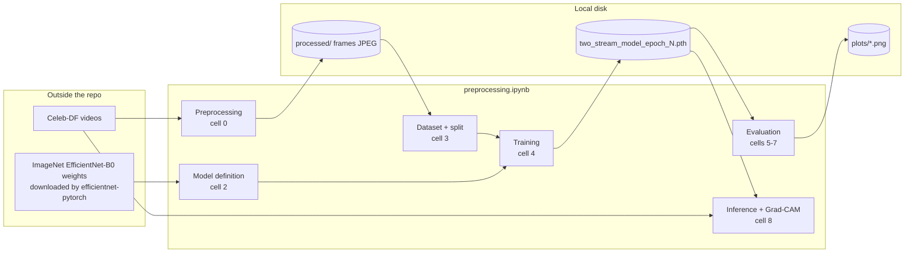
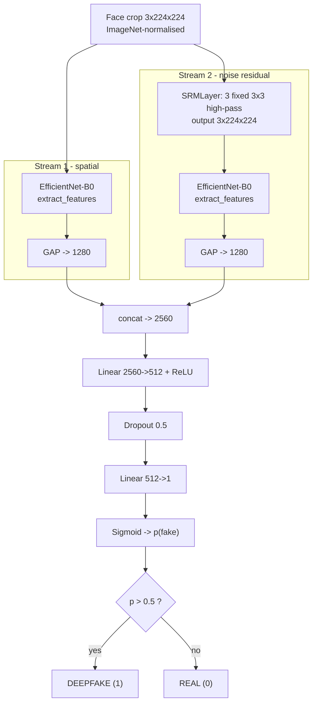
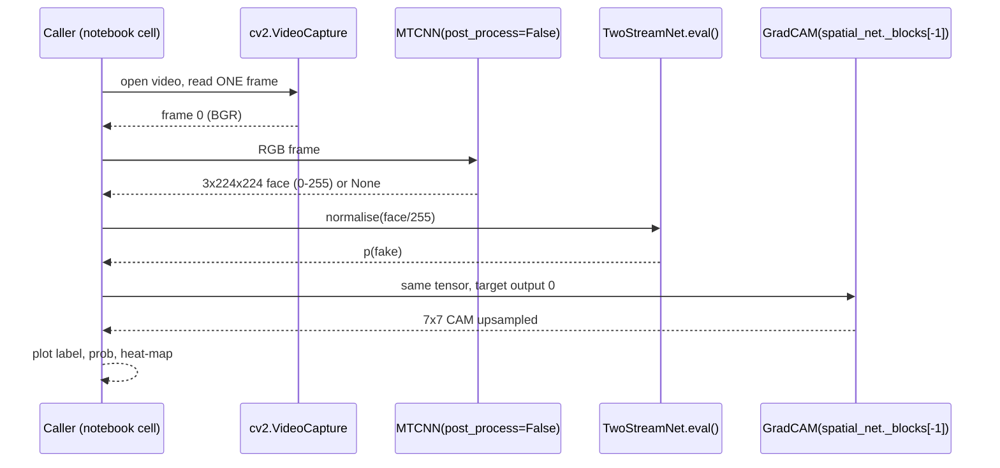

# ARCHITECTURE DEEP DIVE

Scope: the architecture **as implemented** in `backend/scripts/preprocessing.ipynb` (cells referenced as `cell N`, zero-indexed). Status tags: **[V]** verified · **[IU]** implemented-unverified · **[P]** partial · **[N]** not implemented. See `PROJECT_MASTER_CONTEXT.md` for the shared fact base.

## 1. Architectural layers — what exists and what does not

| Layer | Status | Notes |
|---|---|---|
| Frontend (UI, upload form) | **[N]** | No HTML/JS/React anywhere. The only visual output is a Matplotlib window inside the notebook. |
| Backend server / REST API | **[N]** | The folder is named `backend/` but contains no server (no Flask/FastAPI/Django, no routes). |
| Database / persistent storage | **[N]** | Storage = files on disk: JPEG crops, `.pth` checkpoints, PNG plots. |
| Data-preparation module | **[V]** | `extract_faces_balanced` (cell 0). |
| Model module | **[V]** | `SRMLayer`, `TwoStreamNet` (cell 2, duplicated verbatim in cell 8). |
| Training module | **[V]** | `train_model` (cell 4). |
| Evaluation module | **[V]** | `evaluate_model` (cell 5), `evaluate_on_new_data` (cell 6), PR curve (cell 7). |
| Inference + explainability module | **[IU]** | `initialize_engine`, `run_forensic_analysis` (cell 8). |
| Orchestration (`pipeline.py`) | **[N]** | 0-byte file. |

## 2. System context diagram



## 3. Component catalogue (responsibility · input · output)

### 3.1 Frame extraction & face detection — `extract_faces_balanced(category, num_frames=10)` (cell 0) **[V]**
- **Input:** a folder of `.mp4`/`.avi` videos (`../raw_videos/<category>`); `LIMIT=50` videos after `random.seed(42)` shuffle.
- **Process:** `cv2.VideoCapture` → `interval = max(1, total_frames // 10)` → iterate every frame sequentially, keep frames where `count % interval == 0` → BGR→RGB → `MTCNN(image_size=224, margin=20, post_process=True)(frame_rgb, save_path=…)`.
- **Output:** `../new_test_data/<category>/<video_id>/frame_<k>.jpg` — one largest-face crop, 224×224, JPEG. (facenet-pytorch defaults verified in the installed package: `keep_all=False`, `select_largest=True`, thresholds `[0.6,0.7,0.7]`, `min_face_size=20`; the crop is saved **before** the `post_process` standardisation.)
- **Known issue (B2):** `saved` increments even when no face is found.
- **Note:** this saved cell writes to `new_test_data` (the *test* sample). The code that produced `processed/` (training frames) is not in the repo — **UNVERIFIED**, assumed to be the same function with different paths/limits.

### 3.2 `SRMLayer` (cell 2) **[V]**
- **Input:** (B,3,224,224) ImageNet-normalised tensor. **Output:** (B,3,224,224).
- Fixed `nn.Parameter(requires_grad=False)` weight of shape (3,3,3,3), `F.conv2d(stride=1, padding=1)`, no bias.
- Kernels (all ÷4; each sums to zero ⇒ true high-pass):
  - K1 = ¼·[[-1,2,-1],[2,-4,2],[-1,2,-1]]
  - K2 = ¼·[[-1,-1,-1],[-1,8,-1],[-1,-1,-1]]
  - K3 = ¼·[[0,-1,0],[-1,4,-1],[0,-1,0]]
- Each kernel is **repeated identically over the 3 input channels**, so output *k* = K_k ∗ (R+G+B). Consequence: chrominance-specific residuals are collapsed into one luminance-like sum; the layer cannot see inter-channel noise correlations.
- Naming caveat: K1 is the familiar 3×3 "square" residual of the SRM family; K2/K3 are Laplacian-type high-pass filters. They are **SRM-style**, not the 30-filter SRM bank that the README claims. Residual truncation (the T of SRM) is not applied.
- Applied to the *normalised* image, not raw pixel values.

### 3.3 `TwoStreamNet` (cell 2) **[V]**
| Sub-module | Definition | Output |
|---|---|---|
| `spatial_net` | `EfficientNet.from_pretrained('efficientnet-b0')` → `.extract_features(x)` → `adaptive_avg_pool2d(…,1)` | 1280 |
| `srm_layer` | `SRMLayer()` | 3×224×224 |
| `noise_net` | second, independent `EfficientNet-B0` (ImageNet init) on the residual | 1280 |
| `fc` | `Linear(2560,512) → ReLU → Dropout(0.5) → Linear(512,1) → Sigmoid` | p(fake) ∈ (0,1) |

Fusion is **late, concatenation-based, feature-level**. There is no cross-stream attention, no per-stream auxiliary loss, no stream dropout. Both streams are trained jointly with one loss.

### 3.4 Data module — `CelebDFDataset` (cell 3) **[V]**
- Walks `root/{Celeb-real,Celeb-fake}/<video>/<frame>`; label = `enumerate` index (**real=0, fake=1**); returns `(tensor, float32 label)`.
- Transform: `Resize((224,224))` → `ToTensor` → `Normalize(ImageNet mean/std)`. No augmentation.
- `random_split(full, [0.8, 0.2])` at **frame** granularity; `DataLoader(batch_size=4)`; train shuffled.

### 3.5 Training — `train_model(epochs=10)` (cell 4) **[V]**
`BCELoss`, `Adam(lr=1e-4)` over `model.parameters()` (the frozen SRM parameter is included but gets no gradient); `.train()` mode (dropout + BN updating); per-epoch `torch.save(state_dict)`.

### 3.6 Evaluation (cells 5–7) **[V]**
`evaluate_model` → accuracy on val; `evaluate_on_new_data` → accuracy, `classification_report`, seaborn confusion matrix; PR curve via `precision_recall_curve` + `auc`.

### 3.7 Inference + explainability — `initialize_engine`, `run_forensic_analysis` (cell 8) **[IU]**
Flow: load frame 0 → MTCNN (`post_process=False`, raw 0–255 crop) → `/255` → `F.interpolate` to 224 (no-op) → ImageNet normalise → model → `prob`, label `DEEPFAKE if prob>0.5` → Grad-CAM on `spatial_net._blocks[-1]` (target output 0) → 2-panel Matplotlib figure. Recorded output in the notebook is an **error** (`torch.load` without `map_location` on a CPU machine); `image6.3.png` is evidence it succeeded once elsewhere.

## 4. Machine-learning architecture diagram



## 5. Training data-flow (sequence)

```mermaid
sequenceDiagram
  participant DS as CelebDFDataset
  participant DL as DataLoader(bs=4)
  participant NET as TwoStreamNet
  participant OPT as Adam(1e-4)
  loop 10 epochs x 3,996 steps
    DL->>DS: sample (path,label)
    DS-->>DL: tensor 3x224x224, label
    DL->>NET: images
    NET-->>OPT: p = sigmoid(fc(concat(f_rgb, f_noise)))
    OPT->>NET: BCELoss -> backward -> step
  end
  NET->>NET: torch.save(state_dict) each epoch
```

## 6. Inference data-flow (single frame; no video aggregation)



## 7. Video pipeline: designed vs implemented

| Stage | Implemented? |
|---|---|
| Upload & validation | **[N]** (only "can OpenCV read a frame?") |
| Frame sampling at *training* time (uniform ~10/video) | **[V]** |
| Frame sampling at *inference* time | **[N]** (frame 0 only) |
| Face tracking across frames | **[N]** |
| Multi-face handling | **[N]** (largest face only) |
| Per-frame predictions → aggregation (mean/max/vote) | **[N]** |
| Temporal model (LSTM / 3D-CNN / transformer) | **[N]** — the network is purely frame-wise; no temporal parameters exist in the checkpoint |
| Video-level confidence | **[N]** |

## 8. Cross-cutting concerns

- **Device handling:** `cuda if available else cpu` everywhere; inference weight loading is not CPU-safe (B8).
- **Reproducibility:** seeds set for `random` and `torch` (cell 1) but `numpy` and CUDA seeds are not; execution order across cells is non-linear (B15); paths are machine-specific.
- **Resource profile (measured, CUDA, GPU model not recorded):** train ≈10–21 min/epoch at batch 4; eval ≈33–45 images/s; frame extraction ≈1.8 s/video. CPU speed, VRAM, and RAM were **not** measured.
- **Security surface:** none deployed. Notable risks if someone wraps it in a service: `torch.load` on untrusted `.pth` (pickle; use `weights_only=True`), unvalidated upload types, decoding untrusted media with OpenCV/FFmpeg, no size/time limits, no rate limiting.
- **Parameter footprint:** 11.97 M stored floats; ≈2.56 M are unused ImageNet-classifier weights (`_fc` ×2) that could be dropped.

## 9. Inconsistencies between the architecture picture and the code

The README/banner architecture (B4 ×2, 30 kernels, softmax, per-video output, face *alignment*) does **not** match any code or checkpoint. The diagrams in this folder reflect the code. See the ledger in `PROJECT_MASTER_CONTEXT.md` §9.
