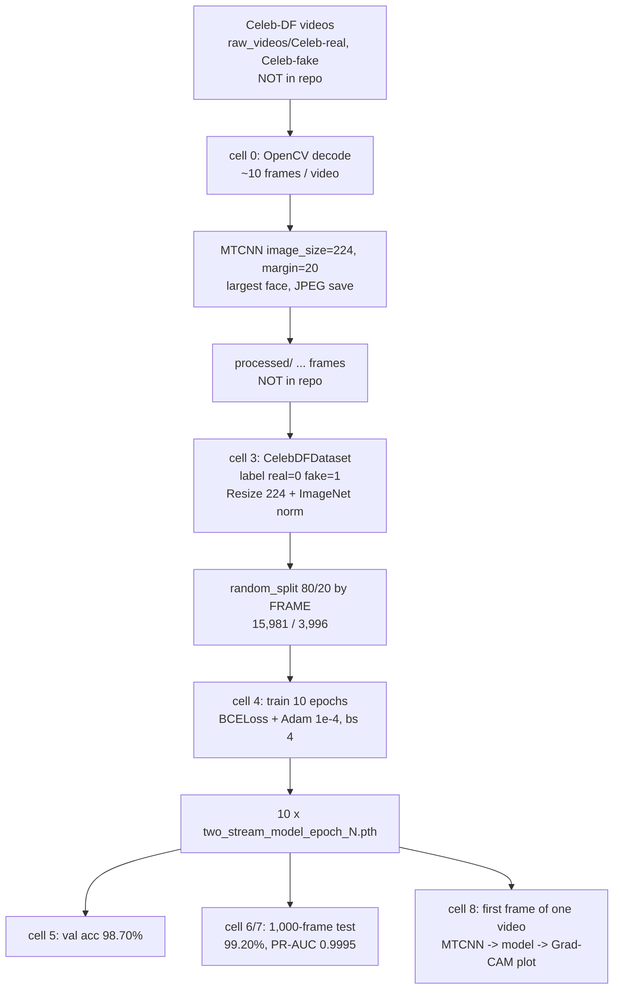

# PROJECT MASTER CONTEXT — Verif-AI / "Two-Stream Deepfake Analyzer"

> Single source of truth for the project as it **actually exists on disk**. Every claim here was checked against source code, executed-notebook outputs, or the model checkpoints themselves. Where a claim could not be verified it is labelled **UNVERIFIED**. Where the README disagrees with the implementation, the implementation wins and the gap is listed in §9.
>
> Analysis date: 2026-11-01. No source files were modified, no model was retrained, nothing was downloaded. Credentials: none found in the repository.

Companion documents (same folder): `TECHNICAL_REPORT.md` (full report), `ARCHITECTURE_DEEP_DIVE.md`, `ML_MODELS_AND_DATASETS.md`, `API_AND_IMPLEMENTATION.md`, `RESEARCH_AND_INNOVATION.md`, `VIVA_PREPARATION.md`.

Status legend used everywhere: **[V]** implemented and verified · **[IU]** implemented, not fully verified · **[P]** partially implemented · **[N]** planned / not implemented.

---

## 1. One-paragraph truth

Verif-AI is a **research notebook** that trains a **frame-level binary classifier** (real=0 / fake=1) on **face crops from Celeb-DF-style face-swap deepfake videos**. The classifier is a **two-stream network**: one ImageNet-pretrained **EfficientNet-B0** sees the normalised RGB face crop, a second EfficientNet-B0 sees a **fixed 3-kernel high-pass (SRM-style) residual** of the same crop; the two 1280-d pooled feature vectors are concatenated and passed through a small MLP with a sigmoid output. It was trained for 10 epochs on 15,981 frames, scored 98.70 % on a random 20 % frame-level validation split, and 99.20 % on a separate 1,000-frame (500 real / 500 fake) sample. There is **no web frontend, no REST API, no database, no deployment, and no automated tests**. Video-level inference is **not implemented**: the single inference function reads **only the first frame** of a video.

## 2. Repository inventory (complete — 25 files)

| Path | Size | What it really is | Status |
|---|---|---|---|
| `Readme.md` | 6.5 KB | Marketing-style README; **contradicts the code in ≥10 places** (§9) | doc |
| `deepfake_banner.svg` | 18.9 KB | Architecture banner; text says "EfficientNet-B4", "30 High-Pass Kernels", "Softmax" — all wrong for the shipped model | doc |
| `image6.3.png` | 235 KB | Screenshot of one Grad-CAM output ("Result: REAL, Prob: 0.0000"). A single example, not evidence of accuracy | asset |
| `backend/requirements.txt` | 1 KB | 13 un-pinned packages; contains problems (§8) | config |
| `backend/.gitignore` | — | Ignores `processed`, `raw_videos`, `venv`, `new_test_data`, `sample_video`. Does **not** ignore `*.pth` | config |
| `backend/scripts/preprocessing.ipynb` | 89.6 KB | **The entire implementation**: 11 cells (10 with code, 1 empty). Despite its name it holds extraction, model, training, evaluation, Grad-CAM inference | [V]/[IU] |
| `backend/scripts/pipeline.py` | **0 bytes** | Empty file | [N] |
| `backend/scripts/plot.py` | 28 lines | Plots training curves from **hard-coded** numbers typed in by hand | [V] (but see §7 bug) |
| `backend/scripts/two_stream_model_epoch_10.pth` | 48,169,403 B | Final checkpoint (md5 `6fbbe0f45607c1235db127909ccec065`) | [V] |
| `backend/models/two_stream_model_epoch_{1..9}.pth` | 48,168,672 B each | Per-epoch checkpoints (epoch 10 lives in `scripts/`, not here) | [V] |
| `backend/plots/confussion matrix.png` | 16 KB | Confusion matrix on the 1,000-frame test sample (filename misspelt) | [V] |
| `backend/plots/precision-recall curve.png` | 16 KB | PR curve, AUC = 0.9995 | [V] |
| `backend/plots/training_performance.png` | 167 KB | Training accuracy/loss curves from `plot.py` (final loss point wrong, §7) | [V] |
| `backend/venv/` | ~3 KB | A **stub** conda environment directory (`.nonadmin`, `conda-meta/`, `etc/`); not a usable environment | — |

Not present anywhere: frontend, server code, API routes, database, Dockerfile, CI config, tests, the dataset, the `processed/` training frames, the code that built `processed/`, the notebooks named in the README (`rgb_stream.ipynb`, `srm_stream.ipynb`, `fusion.ipynb`, `inference.ipynb`), a git history (the folder is not a git repository; README references `github.com/lukkydiwan/two-stream-deepfake-analyzer`).

## 3. What the project can and cannot do

| Capability | Status | Evidence |
|---|---|---|
| Sample frames from videos and crop faces (MTCNN) | **[V]** | Notebook cell 0; output "50/50 [01:30]" |
| Two-stream RGB + noise-residual model | **[V]** | Cell 2; checkpoint tensors match (§4) |
| Train on 15,981 frames, validate on 3,996 | **[V]** | Cells 3–5 outputs |
| Frame-level metrics: acc, precision, recall, F1, confusion matrix, PR-AUC | **[V]** (test sample) | Cells 6–7 + plots |
| ROC-AUC, FPR/FNR as reported metrics, calibration, per-video metrics | **[N]** | Never computed. FPR=FNR=4/500=0.8 % can be *derived* from the confusion matrix |
| Single-face Grad-CAM heat-map (RGB stream only) | **[IU]** | Code in cell 8; `image6.3.png` suggests it once ran; last recorded run in the notebook **errors** |
| Predict on a video file | **[P]** | Reads **frame 0 only**; no sampling, no aggregation |
| Temporal modelling / face tracking / multi-face | **[N]** | No code |
| Detect AI-generated *images* (GAN/diffusion, e.g. StyleGAN, Stable Diffusion) | **[N]** | No such data or code |
| Localise manipulated pixels (segmentation) | **[N]** | Grad-CAM is coarse (7×7) and explains the "fake" logit only |
| Cross-dataset / cross-generator generalisation | **[N]** | Never tested |
| Data augmentation (blur, JPEG, flips) | **[N]** | `albumentations` is in requirements but never imported |
| Upload UI, REST API, auth, storage, deployment | **[N]** | None exists |
| Automated tests | **[N]** | None exists |

**Problem category map** (what the project does *and does not* address):

| Category | Addressed? |
|---|---|
| Deepfake **face-swap video frame** detection (Celeb-DF style) | **Yes — the only thing it does** |
| Real-vs-synthetic **human image** classification (GAN/diffusion faces) | No |
| AI-generated **video** detection (Sora-style text-to-video) | No |
| Face-**manipulation** type attribution (swap vs reenactment vs attribute edit) | No — binary only |
| **Video-level** deepfake verdict | No (first frame only) |

## 4. The model (verified against the checkpoints)

I loaded all ten `.pth` files on CPU with `weights_only=True` (read-only) and confirmed:

- 725 tensors; **11,972,954** floating-point values (parameters + BatchNorm running stats + frozen SRM values).
- `spatial_net.*` = 5,330,613 · `noise_net.*` = 5,330,613 · `srm_layer.kernel` = 81 (shape 3×3×3×3) · `fc.*` = 1,311,745.
- `_conv_stem.weight` is (32, 3, 3, 3) in both streams and `fc.0.weight` is (512, 2560) ⇒ EfficientNet-**B0** (1280-d features), **not B4** (1792-d).
- Each stream still carries the unused ImageNet 1000-class `_fc` head (1,281,000 values ×2 = 2,562,000 dead values, ≈21 % of the checkpoint).
- `srm_layer.kernel` is **bit-identical in all ten checkpoints** (frozen, as coded) and contains **3** kernels, not 30.
- The two streams started from the same ImageNet weights but diverged (mean |Δ| of stem weights = 0.0235 after training) ⇒ both streams were fine-tuned, not frozen.
- Checkpoints differ epoch-to-epoch (L1 distance to epoch 10 falls monotonically 420,119 → 139,051 → 0) ⇒ they are genuine successive snapshots.

```text
face crop (3×224×224, ImageNet-normalised)
   ├── spatial_net (EfficientNet-B0).extract_features → 1280×7×7 → GAP → 1280
   └── srm_layer (3 fixed 3×3 high-pass kernels, stride 1, pad 1) → 3×224×224
          → noise_net (EfficientNet-B0).extract_features → 1280×7×7 → GAP → 1280
concat → 2560 → Linear(2560,512) → ReLU → Dropout(0.5) → Linear(512,1) → Sigmoid → p(fake)
decision: p > 0.5 ⇒ fake
```

Training: `BCELoss`, `Adam(lr=1e-4)`, batch 4, 10 epochs, no scheduler, no weight decay, no augmentation, no early stopping, checkpoint saved every epoch, **no best-epoch selection** (epoch 10 was used by default).

## 5. Data (what is and is not known)

- Dataset: **Celeb-DF** (README says "CelebDF-v2"; folder names `Celeb-real`, `Celeb-fake` match). Raw videos and `processed/` frames are **not in the repo**.
- Training pool: **19,977 face-crop frames** → random 80/20 split → **15,981 train / 3,996 val** (cell 3 output). 19,977 is *not* a multiple of 10, so some videos yielded <10 frames (see bug B2).
- Real/fake ratio of the 19,977 frames, number of videos, and the code that created `processed/`: **UNVERIFIED** (not in repo).
- Separate test sample (`new_test_data`): **1,000 frames, exactly 500 real + 500 fake** (cell 6 output), apparently 50 real + 50 fake videos × 10 frames, drawn with `random.seed(42)` from the same `raw_videos` folder. The saved cell 0 only regenerates the *real* half (`CATEGORIES = ['Celeb-real']`); the fake half was produced by an earlier, unsaved configuration.
- Split is **frame-level, not video-level or identity-level** ⇒ frames of one video can sit in both train and val. The test sample is not excluded from the training videos either. See `ML_MODELS_AND_DATASETS.md` §6.

## 6. Verified results (and what they mean)

| Quantity | Value | Where | Caveat |
|---|---|---|---|
| Final train accuracy (epoch 10, dropout on, running mean) | 0.9921 | cell 4 | Not a generalisation metric |
| Final train loss (epoch 10, epoch mean) | 0.0214 | cell 4 | `plot.py`/PNG show 0.00012 (last mini-batch) — wrong |
| Validation accuracy (3,996 frames, random frame split) | **98.70 %** | cell 5 | Probable same-video leakage |
| Test-sample accuracy (1,000 frames) | **99.20 %** | cell 6 | This is the README's headline number; probable overlap with training videos; **not** the official Celeb-DF test protocol |
| Confusion matrix (rows actual) | Real: 496 TN / 4 FP · Fake: 4 FN / 496 TP | cell 6 + PNG | Fake = positive class |
| Precision / recall / F1 | 0.99 / 0.99 / 0.99 per class (2-decimal rounding) | cell 6 | |
| Derived FPR, FNR | 0.8 % each (4/500) | derived | Not printed by the notebook |
| PR-AUC (fake = positive) | 0.9995 | cell 7 | Trapezoid `auc(recall, precision)` |
| 95 % Wilson interval for 99.20 % on n=1000 | ≈ 98.4 %–99.6 % | derived | Frames are clustered in ≤100 videos ⇒ true interval is wider |
| Throughput (CUDA, GPU model unknown, batch 4) | ≈33 img/s val; ≈45 img/s test; training ≈10–21 min/epoch | cells 4–6 | |

**Not measured:** ROC-AUC, video-level accuracy, calibration (ECE), robustness to compression/resize/blur, cross-dataset performance, inference latency on CPU, memory use.

## 7. Bugs and defects found in the code

| ID | Where | Defect | Impact |
|---|---|---|---|
| B1 | cell 0 `extract_faces_balanced` | Sequential decoding of *every* frame (`cap.read()` loop) just to keep 1 in `interval` | Slow (1.8 s/video), not wrong |
| B2 | cell 0 | `saved += 1` runs even when MTCNN finds no face (returns `None`, writes nothing) | Folders hold <10 frames; the loop may stop before 10 real saves; counts are not what the comment claims |
| B3 | cell 0 | `LIMIT = 50` with comment "only take 500"; `CATEGORIES=['Celeb-real']` with comment "for both categories" | Config drifted from intent; fake test half not reproducible from the saved notebook |
| B4 | cell 3 | `os.listdir` order + `random_split` over **frames** | Frame-level leakage (same video in train and val) |
| B5 | cell 3 | Hard-coded `D:\CHODER\...` paths | Not portable |
| B6 | cell 4 | Accuracy accumulated with dropout active; no validation inside the loop; every epoch saved but none chosen on validation | Reported "accuracy" is training accuracy |
| B7 | cell 2/4 | `Sigmoid` inside the model + `BCELoss` | Numerically less stable than `BCEWithLogitsLoss` (the tqdm output shows loss exactly `0` at epoch 9 — saturated probabilities) |
| B8 | cell 8 | `torch.load(model_path)` without `map_location` | **Recorded run fails** on a CPU-only machine (`Attempting to deserialize object on a CUDA device…`) |
| B9 | cell 8 | "logit vs probability" branch (`if raw_val < 0 or raw_val > 1`) | **Dead code**: the model already ends in a sigmoid |
| B10 | cell 8 | Inference reads only `cap.read()` once (frame 0) | No video-level prediction |
| B11 | cell 8 | Grad-CAM targets `spatial_net._blocks[-1]` and output 0 | Explains only the RGB stream and only the "fake" score, even when the verdict is REAL; SRM stream unexplained |
| B12 | cell 8 vs cell 0 | Training crops were **JPEG-saved** (lossy) before training; inference feeds an **uncompressed** crop tensor | Train/inference preprocessing mismatch — especially risky for a noise-residual stream |
| B13 | cell 9 | `load_state_dict(..., strict=False)`; also errored (`name 'model' is not defined`) | `strict=False` can silently hide mismatches; cell never succeeded |
| B14 | `plot.py` | Metrics hard-coded; last loss `0.00012` is the final **batch** loss, while the epoch mean is 0.0214; last accuracy typed 0.9920 vs notebook 0.9921 | `training_performance.png` right panel falsely shows loss → 0 at epoch 10 |
| B15 | repo | Notebook kernel executions out of order (cell exec counts 7,1,2,3,4,5,11,12,8,1) and run on two machines (training on a `D:` GPU box; inference on a CPU laptop) | Not a reproducible, linear run |
| B16 | `requirements.txt` | Missing `seaborn` (imported); `pytorch-gradcam` is a **different** package from the one imported (`pytorch_grad_cam` ships as `grad-cam`) — in this analysis environment `pytorch_grad_cam` is **not importable** while `gradcam` is; unused: `torchaudio`, `albumentations`, `pandas`; no versions pinned | Fresh install will not run cell 8 or cell 6 |

## 8. Dependencies (declared vs used)

Declared: torch, torchvision, torchaudio, efficientnet-pytorch, facenet-pytorch, opencv-python, albumentations, tqdm, numpy, pandas, matplotlib, scikit-learn, pytorch-gradcam.
Actually imported in the notebook: torch, torchvision, efficientnet_pytorch, facenet_pytorch, cv2, numpy, PIL, tqdm, random, os, sklearn.metrics, matplotlib, **seaborn** (undeclared), **pytorch_grad_cam** (declared under a different name).
Unused: torchaudio, albumentations, pandas. (README also advertises **TensorFlow/Keras** — never used.)
Network at run time: `EfficientNet.from_pretrained` downloads ImageNet weights from GitHub on first call, **even for inference** (seen in cell 8 output).

## 9. README ↔ implementation discrepancy ledger

| # | README / banner says | Reality | Evidence |
|---|---|---|---|
| 1 | TensorFlow / Keras | **PyTorch** | imports; `.pth` files |
| 2 | EfficientNet-**B4** | EfficientNet-**B0** | `from_pretrained('efficientnet-b0')`; 1280-d features; `fc.0.weight` 512×2560 |
| 3 | "30 SRM kernels" | **3** kernels, 3×3 | `srm_layer.kernel` shape (3,3,3,3) |
| 4 | "Concat → Dense → **Softmax**" | single **Sigmoid** unit | `nn.Linear(512,1), nn.Sigmoid()` |
| 5 | "probability **per video**" | per **frame**; inference uses frame 0 only | cell 8 |
| 6 | "Face **Align** + Crop" | detect + crop (MTCNN), **no alignment** | cell 0 |
| 7 | "OpenCV / MTCNN" face detection | OpenCV only decodes video; MTCNN (facenet-pytorch) detects | cell 0 |
| 8 | Four notebooks (`rgb_stream`, `srm_stream`, `fusion`, `inference`) trained separately then fused | One notebook; **both streams trained jointly, end-to-end** | file list; cell 4 |
| 9 | "99.2 % on CelebDF-v2… demonstrates strong generalization" | 99.20 % on a **1,000-frame, self-sampled** set, probably overlapping training videos; no standard protocol, no cross-dataset test | §6 |
| 10 | "Most published models achieve 73–90 % AUC" | Unsourced; and compares AUC (video-level, official split) with frame accuracy | — |
| 11 | Pandas for splits | Not used; split is `random_split` | cell 3 |
| 12 | "Synthesized using … GAN-based face swap" | Celeb-DF fakes come from an improved DeepFake synthesis pipeline (autoencoder-style face swap), per its paper — *external knowledge, not checked here* | — |
| 13 | Zhou et al., "…Tampered Face Detection", **CVPR Workshop 2019** | I believe CVPRW **2017** — **verify before citing** | external knowledge |
| 14 | Project dir `two-stream-deepfake-analyzer/` | Actual folder `Verif-AI/` | — |
| 15 | "B4 chosen as optimal trade-off" | No experiment compares backbones | — |

## 10. Execution flow (as it actually works)



## 11. How to run (what is honestly possible)

1. There is no installer or entry point. Create a Python environment, install the libraries in §8 (add `seaborn`, install `grad-cam` instead of `pytorch-gradcam`).
2. You need the Celeb-DF videos yourself (not included) and must edit the hard-coded `D:\CHODER\...` and `../raw_videos` paths.
3. Inference on CPU requires `torch.load(..., map_location='cpu')` (the notebook's cell 8 omits it) and internet on first run (ImageNet weights download).
4. Nothing in this repository was executed during the analysis other than reading files and loading checkpoints on CPU.

## 12. Top findings at a glance

1. The headline "99.2 % on CelebDF-v2" is a **frame-level accuracy on a 1,000-image self-sampled set**, not a benchmark result. Leakage is probable and undetectable from the repo.
2. The README describes a different (larger, TensorFlow, per-video) system than the one implemented.
3. The model is a legitimate, sensibly designed two-stream baseline that **does train and does converge** (verified) — the engineering around it (video pipeline, serving, tests) is absent.
4. The SRM stream's actual contribution is **unmeasured** (no ablation vs RGB-only).
5. Inference for videos is first-frame-only and the last recorded inference run fails.
