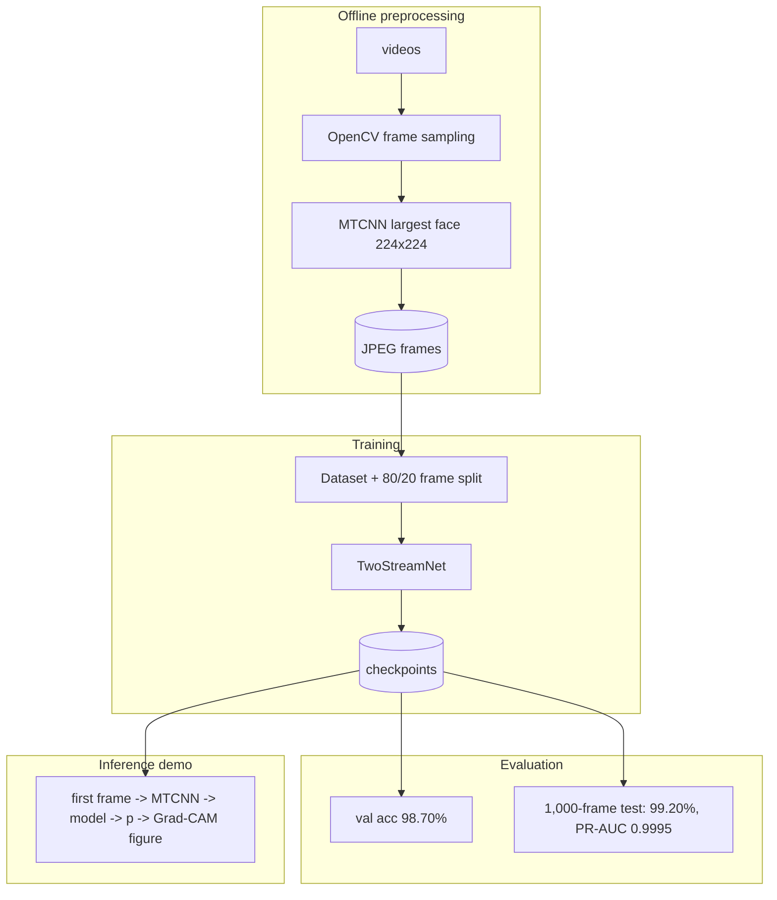
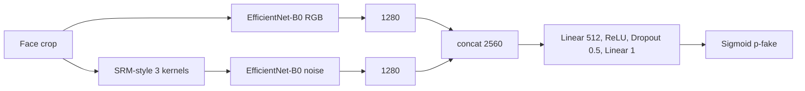

# Two-Stream Face-Swap Deepfake Frame Detection with RGB and Noise-Residual EfficientNet Streams
### Technical Report on the Verif-AI Project (as-implemented analysis)

*Evidence base: source notebook `backend/scripts/preprocessing.ipynb`, `plot.py`, ten model checkpoints, three result plots, README/banner. Analysis date 2026-11-01. Nothing was retrained or downloaded; no source file was modified. Status tags: **[V]** verified · **[IU]** implemented-unverified · **[P]** partial · **[N]** not implemented.*

Related documents: `PROJECT_MASTER_CONTEXT.md` · `ARCHITECTURE_DEEP_DIVE.md` · `ML_MODELS_AND_DATASETS.md` · `API_AND_IMPLEMENTATION.md` · `RESEARCH_AND_INNOVATION.md` · `VIVA_PREPARATION.md`.

---
## 1. Abstract
This report analyses an existing deep-learning project for detecting manipulated human faces in video frames. The implementation is a PyTorch notebook that extracts ~10 frames per video from Celeb-DF, crops the largest face with MTCNN, and trains a two-stream network: an ImageNet-pretrained EfficientNet-B0 on the normalised RGB crop and a second EfficientNet-B0 on a fixed three-kernel high-pass (SRM-style) residual, fused by concatenation (2×1280 → 512 → 1, sigmoid). Training on 15,981 frames for 10 epochs (BCE loss, Adam 1e-4, batch 4) reached 0.9921 training accuracy; a random frame-level validation split (3,996 frames) gave 98.70 %, and a separate 1,000-frame sample (500 real/500 fake) gave 99.20 % accuracy with precision/recall/F1 of 0.99 and PR-AUC 0.9995. These figures are in-distribution frame-level results on self-constructed splits that are exposed to leakage; they are not the standard Celeb-DF protocol. The project has no frontend, API, database, tests or video-level inference; its README describes a different architecture (B4, 30 kernels, TensorFlow, per-video output) from the one actually implemented. The report documents the implementation, quantifies what is and is not established, and proposes experiments to reach publishable rigour.

## 2. Introduction
Photo-realistic synthetic and manipulated faces are now cheap to produce. Detecting them is a binary-classification problem at its simplest, but a generalisation problem in practice. The project examined here takes a classical forensic route: combine content features with noise-residual features from steganalysis. The report treats the repository as the object of study — what exists, how it works, and what the evidence supports.

## 3. Background and Motivation
- **Face-swap deepfakes:** a source identity is rendered onto a target video (typically with encoder–decoder or GAN components) and blended; leaves blending boundaries, texture/frequency anomalies, temporal flicker.
- **Fully synthetic faces:** produced by GANs or diffusion models; different artefact families (up-sampling spectra, texture regularities).
- **Reenactment/attribute edit:** identity-preserving manipulation.
- **Why noise residuals:** steganalysis showed that high-pass residuals suppress content and expose the statistical footprint of processing steps (Fridrich & Kodovsky 2012); two-stream face-tamper detection applied this idea (Zhou et al. 2017 — README cites 2019; verify). *(literature from general knowledge)*
- **Why EfficientNet:** efficient compound-scaled CNNs with strong ImageNet transfer (Tan & Le 2019).
- **Dataset:** Celeb-DF (Li et al. 2020) — higher visual quality than FaceForensics++ and widely used for evaluation.

## 4. Problem Statement
*Given a cropped face from a video frame, predict whether it is real or deepfake, using both RGB appearance and noise-residual evidence, and visualise coarse evidence regions.* The delivered system solves this at **frame level for one dataset**. It does not solve: video-level verdicts, whole-image synthesis detection, manipulation localisation, or cross-generator generalisation.

## 5. Project Objectives (from evidence) and achievement
| Objective (inferred from README + code) | Achieved? |
|---|---|
| Two-stream RGB+noise model | **[V]** |
| High accuracy on Celeb-DF frames | **[V]** in-distribution (98.7–99.2 %), caveats §16 |
| Video-level deepfake analysis | **[P]/[N]** (first-frame only) |
| Explainability | **[IU]** Grad-CAM (RGB stream) |
| Generalisation to hard/real-world data | **[N]** (untested) |
| End-user analyzer (UI/API) | **[N]** |
| Reproducible research pipeline | **[P]** |

## 6. Literature and Existing Approaches
Summarised in `RESEARCH_AND_INNOVATION.md` §3: spatial CNNs (MesoNet, Xception/FF++), two-stream/noise residual (Zhou 2017; Bayar & Stamm 2016), frequency-domain (F3-Net), blending/consistency (Face X-ray), temporal (CNN+LSTM, LipForensics), universal features (UnivFD), datasets (FF++, Celeb-DF, DFDC). Recurrent limitations: shortcut learning, compression sensitivity, poor cross-dataset transfer, lack of calibration, adversarial fragility. *All citations from general knowledge; verify before publication.*

## 7. Proposed Methodology (as implemented)
1. **Sampling:** ~10 uniformly spaced frames per video.
2. **Face extraction:** MTCNN, margin 20, 224×224 largest-face crop, JPEG.
3. **Representation:** (a) normalised RGB; (b) high-pass residual `y_k = K_k ∗ (R+G+B)`, k=1..3.
4. **Learning:** two EfficientNet-B0 feature extractors → GAP → concat → MLP → p(fake).
5. **Objective:** BCE; Adam(1e-4); 10 epochs; checkpoint per epoch.
6. **Decision:** p > 0.5.
7. **Explanation:** Grad-CAM on the RGB stream's last block.
Notably the method is *per frame*; there is no temporal or video-level component.

## 8. System Architecture

No frontend, backend service, API or database exists (**[N]**). Details: `ARCHITECTURE_DEEP_DIVE.md`.

## 9. Dataset Description
- Celeb-DF folders `Celeb-real` (label 0) and `Celeb-fake` (label 1). Official size 590 real + 5,639 fake *(README; matches the paper)*.
- Training pool 19,977 frames (15,981/3,996); class ratio and video count **UNVERIFIED**; generating code absent.
- Test sample 1,000 frames (500/500), drawn with `random.seed(42)` from the same raw folder.
- Leakage risks: frame-level split (high), test/training overlap (high, unprovable), identity overlap (medium–high), codec shortcut (medium).
Full table: `ML_MODELS_AND_DATASETS.md` §2.

## 10. Data Preprocessing
Frame step `interval = max(1, N // 10)`; sequential decode; MTCNN (`image_size=224, margin=20`, `keep_all=False`, `select_largest=True`); JPEG save; training transform Resize→ToTensor→ImageNet Normalize; no augmentation. Defects: `saved` increments without a detection (B2); JPEG used at training but not at inference (B12); hard-coded paths (B5).

## 11. Machine Learning Models
**Model.** `TwoStreamNet` = `spatial_net` (EfficientNet-B0) + `srm_layer` + `noise_net` (EfficientNet-B0) + head. 11,972,954 stored values (verified in checkpoint), of which 2,562,000 are unused ImageNet classifier weights.

**SRM front-end.** With zero-sum kernels
K1=¼[[-1,2,-1],[2,-4,2],[-1,2,-1]], K2=¼[[-1,-1,-1],[-1,8,-1],[-1,-1,-1]], K3=¼[[0,-1,0],[-1,4,-1],[0,-1,0]]:
`y_k = K_k ∗ (x_R + x_G + x_B)`.

**Head and loss.** `p = σ(W₂ · Dropout(ReLU(W₁[f_rgb; f_noise]))`, `L = −mean[y log p + (1−y) log(1−p)]`.

**Training.** Adam(1e-4), batch 4, 10 epochs, no scheduler/augmentation/early stopping.

| Epoch | 1 | 2 | 3 | 4 | 5 | 6 | 7 | 8 | 9 | 10 |
|---|---|---|---|---|---|---|---|---|---|---|
| Loss | .2883 | .0915 | .0552 | .0436 | .0340 | .0305 | .0294 | .0238 | .0211 | .0214 |
| Train acc | .8707 | .9653 | .9790 | .9830 | .9867 | .9884 | .9887 | .9900 | .9915 | .9921 |

Model interaction: concatenation only; stream contributions unmeasured. See `ML_MODELS_AND_DATASETS.md` §1.

## 12. Image Detection Implementation
Frame-level classification **[V]**: MTCNN crop → normalise → `TwoStreamNet` → p(fake) → threshold 0.5. Single-image function: `run_forensic_analysis` (cell 8) **[IU]**, which accepts a *video path* and uses frame 0. Explainability: Grad-CAM (`pytorch_grad_cam`) on `spatial_net._blocks[-1]`, target output 0. The notebook's recorded run of this cell ends in a CUDA→CPU deserialisation error; `image6.3.png` is evidence of a prior success. "Confidence" = p(fake), uncalibrated. This is a *face-forensics* classifier, not a general AI-image detector.

## 13. Video Detection Implementation
| Stage | Status |
|---|---|
| Frame sampling (training data) | **[V]** |
| Face detection | **[V]** per frame |
| Tracking | **[N]** |
| Per-frame prediction | **[V]** |
| Temporal modelling | **[N]** |
| Aggregation to video verdict | **[N]** |
| Inference uses | first frame only |
No video-level confidence exists. Processing speed measured only for extraction (≈1.8 s/video) and batched classification (≈33–45 frames/s on CUDA).

## 14. Backend and Frontend Implementation
**Frontend: [N]. Backend API: [N]. Database: [N]. Deployment: [N]. Tests: [N].** The `backend/` folder contains the notebook and artefacts only. A proposed (unimplemented) service design is in `API_AND_IMPLEMENTATION.md` §5.

## 15. Experimental Setup
| Item | Value |
|---|---|
| Framework | PyTorch (+ efficientnet-pytorch, facenet-pytorch) |
| Hardware | CUDA GPU (model unrecorded); inference attempt on CPU laptop |
| Python | notebook kernel metadata: 3.13.12 |
| Seeds | `random` & `torch` = 42 |
| Splits | random 80/20 over frames; separate 1,000-frame sample |
| Batch | 4 |
| Wall time | ≈2 h 05 min training |
| Logging | stdout only; plot values re-typed in `plot.py` |

## 16. Results and Performance Evaluation
| Metric | Value | Basis |
|---|---|---|
| Train accuracy (final) | 0.9921 | cell 4 |
| Validation accuracy | 98.70 % | 3,996 frames |
| Test-sample accuracy | 99.20 % | 1,000 frames |
| Precision / Recall / F1 | 0.99 / 0.99 / 0.99 (both classes) | cell 6 |
| Confusion matrix | [[496,4],[4,496]] | cell 6, plot |
| FPR / FNR | 0.8 % / 0.8 % | derived |
| PR-AUC | 0.9995 | cell 7 |
| ROC-AUC, video-level, calibration, robustness, cross-dataset | **not measured** | — |
| 95 % Wilson interval (n=1000, independence assumed) | ≈98.4–99.6 % | derived |
Plots: `backend/plots/confussion matrix.png`, `precision-recall curve.png`, `training_performance.png` (right-hand loss panel wrongly ends at ≈0; true epoch-10 mean loss is 0.0214).

## 17. Discussion
The two-stream baseline learns the training distribution quickly (87 % after one epoch) and scores near-perfectly on in-distribution held-out frames. That is unsurprising for Celeb-DF frames from a pool shared across splits: the dominant risk is that the model memorises video- or identity-specific cues. Three observations temper the headline figure: (i) the "new" sample scores slightly higher than validation, suggesting it is not harder; (ii) the confusion matrix is perfectly symmetric (4/4), typical of a saturated regime; (iii) no ablation shows the SRM stream's contribution. Positive findings: the implementation is clean, compact (48 MB), converges stably, and its design is well-motivated. The README overstates (B4, 30 kernels, "strong generalization") and mis-describes the pipeline; the corrected claim is "98.7–99.2 % frame-level accuracy on random in-distribution Celeb-DF splits."

## 18. Limitations
1. No generalisation evidence (single dataset/generator).
2. Probable leakage (frame split; test pool overlap; identities).
3. Frame-level only; first-frame inference; no temporal cues.
4. No augmentation/robustness testing; possible compression shortcut.
5. Train/inference preprocessing mismatch (JPEG).
6. Uncalibrated, saturated probabilities; fixed threshold.
7. Grad-CAM covers only the RGB stream and the fake logit.
8. Tooling: empty `pipeline.py`, hard-coded paths, wrong/missing dependencies, non-linear notebook, no tests/API/UI.
9. Hardware metrics (CPU latency, VRAM) unmeasured.
10. Adversarial robustness unknown.
**What it can reliably claim:** discrimination between real and Celeb-DF-style fake frames similar to those it was trained on. **What it cannot:** detect unseen generators, whole-image AI faces, AI video, or guarantee authenticity.

## 19. Future Scope
Video-level aggregation and a temporal head; video+identity-disjoint evaluation on the official list; ablations (RGB/SRM/fused; 30-filter bank; learnable constrained conv); compression-augmented training; cross-dataset (FF++, DFDC, DFD) and cross-generator (StyleGAN, diffusion) tests; calibration and threshold selection; CAM on both streams; ONNX export/CPU latency; a proper service with validation, quotas and `weights_only` loading; repository hygiene (pinned deps, README correction, Git LFS for weights).

## 20. Conclusion
Verif-AI is a sound, small two-stream deepfake-frame classifier with verified training and in-distribution evaluation results (98.70 % validation, 99.20 % on a 1,000-frame sample). It is a research prototype, not a deployed analyzer: no video-level pipeline, no interface, and no evidence yet for generalisation. Correcting the README, repairing the inference path, and running the evaluation protocol in §19 would convert it from a promising baseline into defensible research.

## 21. References
*(Recalled from general knowledge — verify bibliographic details before citing.)*
1. Li, Y. et al. *Celeb-DF: A Large-scale Challenging Dataset for DeepFake Forensics.* CVPR 2020.
2. Fridrich, J., Kodovsky, J. *Rich Models for Steganalysis of Digital Images.* IEEE TIFS 2012.
3. Tan, M., Le, Q. *EfficientNet: Rethinking Model Scaling for CNNs.* ICML 2019.
4. Zhou, P. et al. *Two-Stream Neural Networks for Tampered Face Detection.* CVPR Workshops 2017 (README: 2019).
5. Zhang, K. et al. *Joint Face Detection and Alignment Using Multitask Cascaded Convolutional Networks* (MTCNN). IEEE SPL 2016.
6. Selvaraju, R. et al. *Grad-CAM.* ICCV 2017.
7. Rössler, A. et al. *FaceForensics++.* ICCV 2019.
8. Bayar, B., Stamm, M. *A Deep Learning Approach to Universal Image Manipulation Detection Using a New Convolutional Layer.* IH&MMSec 2016.
9. Qian, Y. et al. *Thinking in Frequency (F3-Net).* ECCV 2020.
10. Li, L. et al. *Face X-ray for More General Face Forgery Detection.* CVPR 2020.
11. Dolhansky, B. et al. *The DeepFake Detection Challenge Dataset.* 2020.
12. Haliassos, A. et al. *Lips Don't Lie (LipForensics).* CVPR 2021.
13. Ojha, U. et al. *Towards Universal Fake Image Detectors that Generalize Across Generative Models.* CVPR 2023.
14. Güera, D., Delp, E. *Deepfake Video Detection Using Recurrent Neural Networks.* AVSS 2018.

## 22. Technical Appendix
### A. Technology inventory
| Category | Technology | Where / why |
|---|---|---|
| Language | Python | everything |
| DL framework | PyTorch, torchvision | model, training, transforms |
| Backbone lib | efficientnet-pytorch | EfficientNet-B0 + ImageNet weights |
| CV / detection | OpenCV, facenet-pytorch (MTCNN) | decoding; face detection/crop |
| Explainability | pytorch_grad_cam (declared as `pytorch-gradcam` — mismatch) | Grad-CAM |
| ML utils | scikit-learn | metrics |
| Visualisation | matplotlib, seaborn (undeclared) | plots |
| Misc | numpy, Pillow, tqdm | arrays, I/O, progress |
| Notebook | Jupyter (nbformat 4) | all development |
| Declared, unused | torchaudio, albumentations, pandas; README: TensorFlow/Keras | — |
| Backend/frontend/DB/deploy/test tooling | none | — |

### B. Code reference index
`extract_faces_balanced` (cell 0) · `SRMLayer`, `TwoStreamNet` (cell 2, copy in 8) · `CelebDFDataset`, `transform` (cell 3) · `train_model` (cell 4) · `evaluate_model` (5) · `evaluate_on_new_data` (6) · PR block (7) · `initialize_engine`, `run_forensic_analysis` (8) · `deep_load_and_test` (9, never ran successfully) · `backend/scripts/plot.py`.

### C. Checkpoint verification (performed)
Loaded all ten `.pth` on CPU (`weights_only=True`): 725 tensors; 11,972,954 floats; `spatial_net`/`noise_net` 5,330,613 each; `fc` 1,311,745; `srm_layer.kernel` (3,3,3,3), identical across epochs; `fc.0.weight` (512,2560); epoch-10 md5 `6fbbe0f45607c1235db127909ccec065`.

### D. Feature-status register
| Feature | Status |
|---|---|
| Frame extraction, MTCNN crop | **[V]** |
| SRM + RGB two-stream model | **[V]** |
| Training with checkpoints | **[V]** |
| Frame-level accuracy/P/R/F1/CM/PR-AUC | **[V]** (leakage caveats) |
| Grad-CAM inference | **[IU]** |
| Video inference | **[P]** |
| Temporal modelling, tracking, aggregation | **[N]** |
| Augmentation | **[N]** |
| ROC-AUC, robustness, cross-dataset, calibration | **[N]** |
| AI-generated image/video detection | **[N]** |
| Frontend, API, DB, deployment, tests | **[N]** |

### E. Unverifiable items
Training video counts and class ratio; code for `processed/`; GPU model; official Celeb-DF version; provenance of fake half of the test sample; whether test videos overlap training videos; source of README's "73–90 % AUC"; Grad-CAM image provenance; correctness of README citations (e.g. Zhou et al. year).
